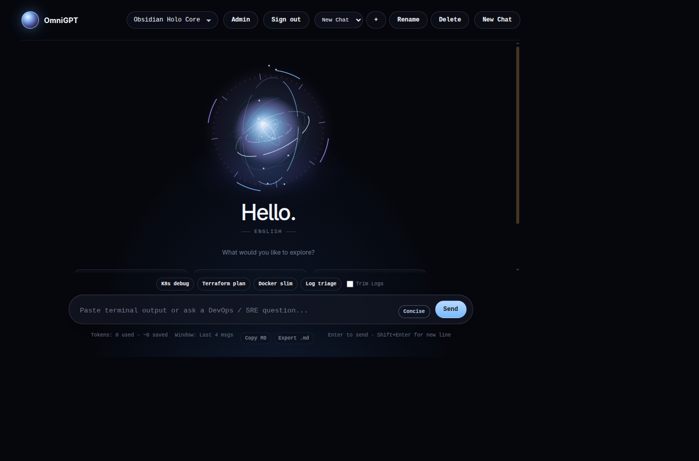

# OmniGPT



OmniGPT is a FastAPI DevOps/SRE assistant using the server-locked Groq model `openai/gpt-oss-20b`. It includes HMAC-signed bearer authentication, streamed replies, adjustable context and output-token controls, concise/detailed response modes, named browser-local chat sessions with rolling summaries, DevOps playbooks, log trimming, ten themes, a 3D holographic orb, Admin usage metrics and session guardrails, and Markdown runbook copy/export.

## Configuration

Set `LLM_API_KEY` and `AUTH_SECRET`. Configure at least one sign-in method: `USER_ACCESS_KEY`, or the `ADMIN_USERNAME` and `ADMIN_PASSWORD` pair.

| Variable | Purpose |
| --- | --- |
| `LLM_API_KEY` | Groq API key |
| `AUTH_SECRET` | HMAC bearer-token signing secret |
| `USER_ACCESS_KEY` | Optional user sign-in access key |
| `ADMIN_USERNAME` | Optional admin username |
| `ADMIN_PASSWORD` | Optional admin password |

Optional settings (also configurable in the Render dashboard):

| Variable | Default | Purpose |
| --- | --- | --- |
| `DEFAULT_MAX_TOKENS` | `650` | Default output-token limit; adjustable in Admin settings |
| `RECENT_WINDOW_MESSAGES` | `4` | Recent messages sent as full chat context |
| `SUMMARY_TRIGGER_MESSAGES` | `8` | Message count that triggers rolling summaries |
| `REQUEST_TIMEOUT_SECONDS` | `180` | Upstream request timeout |
| `SESSION_MESSAGE_CAP` | `50` | User messages allowed per browser chat session |
| `SESSION_TOKEN_CAP` | `20000` | Approximate token budget per user chat session |

The browser offers Concise (450 tokens) and Detailed (1400 tokens) modes. The model and Groq endpoint are configured in the server and are not user-overridable.
Admins can adjust the session caps in Admin settings. Usage counters and enforcement state are in memory and reset when the server restarts; admins bypass user caps.

## Run locally

```bash
pip install -r requirements.txt
uvicorn app:app --host 0.0.0.0 --port 8000
```

Set the required environment variables before starting the server.

## Deploy on Render

Create a Render Blueprint from this repository; [`render.yaml`](render.yaml) defines the Python web service, install command, and Uvicorn start command. Set the required secrets in the Render dashboard, optionally override the token/window settings there, then deploy. Render supplies `PORT` to the configured start command.
